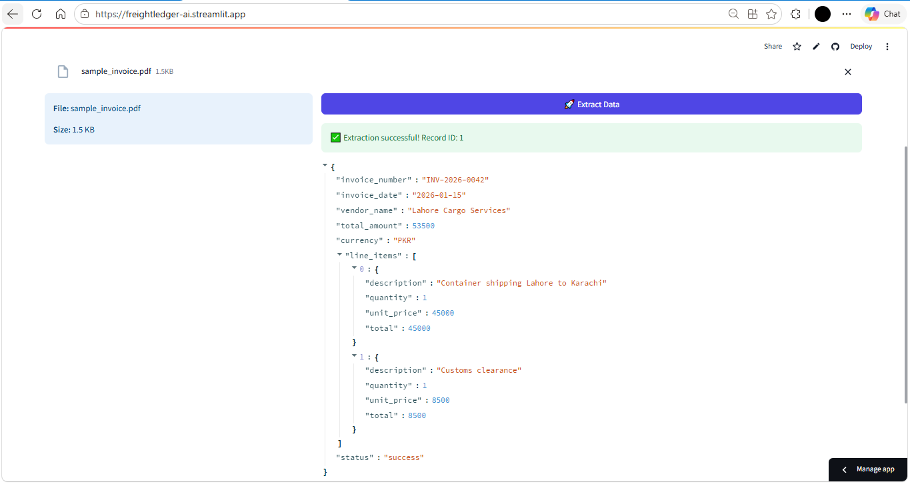

# 🚚 FreightLedger AI

[](https://freightledger-ai.streamlit.app/)
[](https://www.python.org/downloads/)
[](https://opensource.org/licenses/MIT)
[](https://python.langchain.com/)
[](https://groq.com/)

> **AI-powered freight invoice extraction agent** — reads PDF and scanned invoices, extracts structured data in seconds, and stores it in a database. Built entirely with free tools.

## 🔗 Live Demo

👉 **[https://freightledger-ai.streamlit.app/](https://freightledger-ai.streamlit.app/)**

## 🖼️ Screenshot



## 🎯 What It Does

- 📄 Reads freight invoice PDFs (both text-based AND scanned images)
- 🧠 Extracts key fields using a LangChain AI agent powered by Groq
- ✅ Validates data against business rules (Pydantic)
- 💾 Stores results in SQLite with full history
- 🌐 Provides both a Streamlit web UI and a FastAPI REST API
- 🔍 Falls back to OCR (Tesseract) for image-based PDFs

**Extracted fields:**

- Invoice Number
- Invoice Date
- Vendor Name
- Total Amount
- Currency
- Line Items (description, quantity, unit price, total)

## 🛠️ Tech Stack

| Layer | Technology | Cost |
| :--- | :--- | :--- |
| **LLM** | Groq (Llama 3.3 70B / GPT-OSS 120B) | Free |
| **Agent Framework** | LangChain + ReAct | Free |
| **PDF Parsing** | pdfplumber | Free |
| **OCR** | pytesseract + pdf2image | Free |
| **Validation** | Pydantic v2 | Free |
| **Backend** | FastAPI + Uvicorn | Free |
| **Frontend** | Streamlit | Free |
| **Database** | SQLite + SQLAlchemy | Free |
| **Deployment** | Streamlit Community Cloud | Free |

**Total cost to build and run: $0**

## 🚀 Quick Start (Local)

### Prerequisites

- Python 3.12 or 3.13
- A free Groq API key: [console.groq.com](https://console.groq.com)

### Setup

```bash
git clone https://github.com/abdullahbinmasood702/freightledger-ai.git
cd freightledger-ai

python -m venv venv
venv\Scripts\activate          # Windows
# source venv/bin/activate     # Mac / Linux

pip install -r requirements.txt
```

Then create a `.env` file in the project root with:

```env
GROQ_API_KEY=gsk_your_real_key_here
```

### Run the Streamlit UI

```bash
streamlit run app.py
```

Opens at `http://localhost:8501`.

### Run the FastAPI Backend (Optional)

```bash
uvicorn main:app --reload
```

- API docs: `http://127.0.0.1:8000/docs`
- Health check: `http://127.0.0.1:8000/health`

### Run the Agent from CLI

```bash
python agent.py invoices\sample_invoice.pdf
```

## 📊 API Endpoints

| Method | Endpoint | Description |
| :--- | :--- | :--- |
| `POST` | `/extract` | Upload a PDF invoice and get structured JSON |
| `GET` | `/invoices` | List previously processed invoices |
| `GET` | `/health` | Health check |

### Example: Extract via curl

```bash
curl -X POST http://127.0.0.1:8000/extract \
  -F "file=@invoices/sample_invoice.pdf"
```

### Example Response

```json
{
  "status": "success",
  "record_id": 1,
  "invoice": {
    "invoice_number": "INV-2026-0042",
    "invoice_date": "2026-01-15",
    "vendor_name": "Lahore Cargo Services",
    "total_amount": 53500.0,
    "currency": "PKR",
    "line_items": [
      {
        "description": "Container shipping Lahore to Karachi",
        "quantity": 1,
        "unit_price": 45000,
        "total": 45000
      },
      {
        "description": "Customs clearance",
        "quantity": 1,
        "unit_price": 8500,
        "total": 8500
      }
    ]
  }
}
```

## 📁 Project Structure

```text
freightledger-ai/
├── agent.py                 # LangChain agent (core extraction logic)
├── app.py                   # Streamlit UI
├── main.py                  # FastAPI backend
├── models.py                # Pydantic schemas
├── database.py              # SQLite + SQLAlchemy
├── make_sample_pdf.py       # Generates a sample invoice for testing
├── requirements.txt
├── Dockerfile
├── .env                     # NOT committed (in .gitignore)
├── .gitignore
├── README.md
├── LICENSE
├── .streamlit/
│   └── config.toml
├── tools/
│   ├── __init__.py
│   ├── pdf_tool.py          # pdfplumber text extraction
│   ├── ocr_tool.py          # Tesseract OCR fallback
│   └── email_tool.py        # Email logging (placeholder)
├── tests/
│   ├── __init__.py
│   └── test_agent.py        # Pytest tests
├── docs/
│   ├── screenshot.png       # App screenshot
│   └── usage.md             # Extended usage guide
├── invoices/                # Uploaded invoices (gitignored)
└── data/                    # Email logs, temp data
```

## 🧪 Running Tests

```bash
pytest tests/
```

## 🐳 Docker

```bash
docker build -t freightledger-ai .
docker run -p 8501:8501 -e GROQ_API_KEY=your_key_here freightledger-ai
```

## 💡 Use Cases

- **Freight forwarders** — automate invoice data entry
- **Logistics companies** — reconcile vendor invoices
- **Customs agents** — extract shipment details
- **Accounting firms** — bulk-process client invoices
- **ERP integrators** — pipe invoice data into ERP systems

## 🗺️ Roadmap

- [x] LangChain agent with Groq
- [x] PDF text extraction
- [x] OCR for scanned invoices
- [x] Pydantic validation
- [x] SQLite persistence
- [x] FastAPI backend
- [x] Streamlit UI
- [x] Free cloud deployment
- [ ] Excel export
- [ ] Multi-language invoices (Urdu support)
- [ ] Email inbox monitoring (autonomous workflow)
- [ ] ERP integrations (QuickBooks, SAP)

## 🤝 Contributing

Issues and pull requests welcome.

## 👤 Author

**Abdullah Bin Masood**

- GitHub: [@abdullahbinmasood702](https://github.com/abdullahbinmasood702)
- Live Demo: [freightledger-ai.streamlit.app](https://freightledger-ai.streamlit.app/)
- Data Science Student, UET Lahore

## 📜 License

MIT — see [LICENSE](LICENSE) for details.

---

⭐ **If this project helped you, please give it a star!**